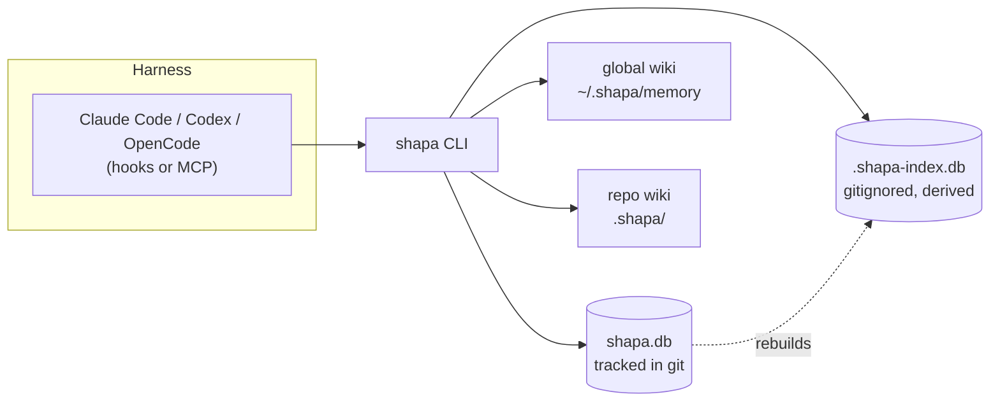

# shapa

[](https://github.com/Roukh/shapa-llm/actions/workflows/test.yml)
[](https://pypi.org/project/shapa/)
[](https://pypi.org/project/shapa/)
[](LICENSE)

shapa gives a coding agent memory and a work ledger that live in one SQLite
file per project, checked into git, with hooks for Claude Code, Codex and
OpenCode.

## Install

Once shapa is on PyPI:

```bash
uv tool install 'shapa[semantic,mcp]'
# or
pipx install shapa
```

Until then, install straight from GitHub:

```bash
curl -fsSL https://raw.githubusercontent.com/Roukh/shapa-llm/main/bootstrap.sh | sh
```

`bootstrap.sh` installs the `shapa` command (pipx, then uv, then `pip
--user`) and wires Claude Code's hooks. Pass `--with-semantic`, `--with-mcp`
or `--full` to add the optional extras up front; see the comments at the top
of the script for every flag and environment variable.

## 60-second quickstart

```bash
# 1. Install shapa (see above).

# 2. In a git repo, create its wiki:
cd your-project
shapa init

# 3. Check that everything is wired correctly:
shapa doctor

# 4. Start your agent as usual. In Claude Code, shapa's hooks load memory
#    at session start and on every prompt; Codex and OpenCode reach the
#    same memory through shapa's MCP tools.
```

`shapa init` finds the git top level, creates `.shapa/` there and nothing
else, and installs two git hooks: `pre-commit` keeps the database off
feature branches, and `post-commit` closes the job a `J<n>:` commit names.
It never writes into a machine-wide `core.hooksPath` or into hooks owned by
husky, lefthook or the pre-commit framework; it prints the lines to add
there instead.

## What it does

- Starts a session on what matters: the northstar, then the three big fires
  (`shapa focus`) and only their tree, not every row. Closing a fire's
  feature frees its slot and promotes the next candidate.
- Partitions the code per fire. `shapa map` builds a graph of the checkout
  (files, functions, imports and calls; Python by `ast`, JavaScript and
  TypeScript by regex) into a derived, gitignored index; `shapa partition`
  lists a fire's related files, bounded: the files its feature, jobs and
  tasks name, the files recalled for their words, and the callers and
  importers a change reaches, each with why it is there. Session start shows
  each fire's top files. It is local: it needs the checkout, so the hosted
  store neither holds nor serves it.
- Injects relevant memory on every prompt, ranked by relevance.
- Keeps skills as versioned records and one document per project; a
  correction that names a skill files a pending new version of it, never an
  active one.
- Turns an operator's correction ("no", "wrong", "not like this") into an
  attributed issue row, not a buried chat line, and closes the loop so it is
  never made twice (see Learning loop below).
- Tracks work as a three-level ledger: a feature (`F`, a new capability
  with its own branch and PR) holds jobs (`J`, one commit each), and a job
  holds tasks (`T`). Fixes, docs and release work are standalone jobs that
  share one batch branch and PR per session. A commit whose subject starts
  `J<n>:` closes that job automatically.
- Sweeps the database after every merged feature: closed, expired,
  duplicate, superseded and stale rows are deleted, and the database's git
  history keeps the record.
- Commits `.shapa/` on the default branch at the end of each Claude Code
  session (`shapa commit`), so a clone of the repo carries its memory. It
  commits only wiki paths and never pushes.

## How it works



A repo's wiki is `.shapa/` at its git top level; the global wiki defaults to
`~/.shapa/memory`. Each holds `shapa.db`: the work ledger plus memory, rule
and issue rows. A second file, `.shapa-index.db`, holds the search index and
vectors; it is derived from `shapa.db`, gitignored, and rebuilt on demand. A
session reads from the global wiki and the current repo's wiki together, and
writes are scoped to one or the other.

## Harness support

| Harness | Hooks | MCP |
|---|---|---|
| Claude Code | yes | yes |
| Codex | no | yes |
| OpenCode | no | yes |
| anything else that speaks MCP | no | by hand (see `shapa mcp`) |

Hooked harnesses get memory pushed to them automatically; any MCP client can
pull the same `search`, `get` and `save` tools by registering `shapa mcp` as
a stdio server itself.

## How it compares

Figures below are each project's own numbers, checked in October 2026; they
move fast and several benchmark claims in this space are disputed.

| Tool | Storage | Git-tracked | Work ledger | License |
|---|---|---|---|---|
| **shapa** | one SQLite file per wiki | yes, on the default branch | yes (F/J/T) | MIT |
| claude-mem | SQLite plus Chroma | no | no | Apache-2.0 |
| mem0 + OpenMemory MCP | vector DB plus graph | no | no | Apache-2.0 |
| basic-memory | Markdown plus wikilinks, Obsidian sync | if you commit the files | no | AGPL-3.0 |
| beads | Dolt, JSONL export | yes | yes (dependency graph, not memory) | MIT |
| native harness memory (Claude Code, Codex, Cursor, ...) | machine-local files | no | no | - |

None of the native, per-harness memory features are git-tracked, shared
across harnesses, split into a global and a repo tier, or tied to a work
ledger. The trade-off: a SQLite file does not diff or merge like Markdown,
which is why shapa commits it only on the default branch.

## Commands

| Command | Does |
|---|---|
| `shapa init [DIR] [--no-git] [--obsidian] [--global]` | create and register a wiki, with git hooks in a repo |
| `shapa doctor` | check the whole install; exits 1 with a fix command per problem |
| `shapa status` | the same report as `doctor`, without the exit code |
| `shapa commit [--hook] [--dry-run] [--json] [--scrub TERM]` | commit `.shapa/` on the default branch |
| `shapa bootstrap [--full]` | session start: the northstar, the three fires and only their tree (`--full`: every ranked row and the open ledger) |
| `shapa focus show\|northstar\|fire\|unfire\|order\|rank\|candidates\|promote` | the northstar and the three ranked big fires of a wiki scope |
| `shapa skill list\|show\|add\|update\|activate` | skills as versioned records, global or per repo |
| `shapa learn pending\|apply\|dismiss\|merge\|principles` | generalize corrections into cross-repo principles (see Learning loop) |
| `shapa metrics [--since DATE] [--json] [--snapshot] [--all] [--repo KEY] [--history DAYS]` | whether the wiki is working: latency against record count, repeats, learning, work on the fires; `record skill-use NAME --session ID` |
| `shapa map [--seconds N] [--rebuild] [--json]` | build or refresh this checkout's code map (a derived, gitignored `.shapa-code.db`) |
| `shapa partition [F<n>\|1\|2\|3] [--max-files N] [--max-bytes N] [--no-refresh] [--json]` | a fire's related files as one bounded partition, each with why |
| `shapa fetch` | rank and surface memory relevant to a prompt |
| `shapa get ID` | print a row's or a note's full text |
| `shapa save` | write one note or row (`--scope global\|repo\|external`) |
| `shapa row add\|edit\|rm\|link\|tag\|list` | manage memory, rule and issue rows |
| `shapa doc add\|edit\|rm\|list\|merge` | manage documents (a titled body kept whole; `shapa get D<n>` prints one); a project keeps one, a second is refused naming it or appended with `--merge` |
| `shapa remote login\|sync\|status\|devices\|logout\|instructions` | the opt-in hosted store (see Hosted) |
| `shapa ledger add\|claim\|close\|tree\|issues` | manage the work ledger |
| `shapa correction` | record an operator correction as an issue row |
| `shapa maintain [--prune] [--dry-run]` | self-heal: merge duplicates, prune stale and orphaned rows |
| `shapa validate` | check note and wiki frontmatter |
| `shapa upgrade [--all] [--check]` | bring a wiki to the current format |
| `shapa mcp` | run the MCP stdio server (`search`, `get`, `save`, `placement`, `focus`, `skill`, `partition`) |
| `shapa serve` | run the optional warm per-wiki daemon |

Run `shapa` with no arguments for the full, versioned usage text.

## Learning loop

A correction is made once. The `UserPromptSubmit` hook files it as an issue
row and compares it (stemmed-token similarity, plus vector cosine with
`[semantic]`) with every earlier issue and rule of the repo wiki and the
global wiki. A close match is a **repeat**: it is tagged `repeat`, linked
`related`, the earlier row's count goes up, and when the earlier row was a
learned principle it is a **violation** of it.

`shapa learn pending [--json] [--limit N]` lists what no one has generalized yet
(newest cap first, the limit applied before any search), each with its nearest
rules, skills and issues (score, and whether it would merge), the corrections
that are only *soft* candidates, and the skill versions a learned principle
filed that await `shapa skill activate`. `shapa learn apply ISSUE --principle
TEXT` records the principle the correction implies, and you choose where it
goes:

- **`--into R<n>` (or `global/R<n>`, `repo/R<n>`) merges, `--new` adds, `--into
  skill:NAME` files a lesson for a skill.** Matching words cannot decide
  meaning, so with neither flag and any candidate the call exits 2 and prints
  the candidates (`--json`: `{"error":"choose","candidates":[...]}`). A wiki
  keeps at most 60 principles; `shapa learn merge SRC DST` folds two.
- **Global by default.** Principles hold across repos; `--scope repo` is the
  exception and needs `--why`, stored on the row. A principle for a skill is a
  rule that carries `skill:NAME`: it is in effect at once, and the skill gets a
  PENDING new version with the lesson quoted. Only `shapa skill activate`
  makes it live.
- **One principle, many corrections.** A principle is one rule row: the
  statement is its summary, its body holds the evidence (source corrections:
  id, wiki key, date, text; at most 12 kept) and any reworded `Also:` line. A
  principle that contradicts a rule is filed beside it, linked `conflicts`, and
  an `--into` of a contradicted rule is refused. Its tags carry
  `violations:N`, `revisions:N`, `evidence:N`, `last-seen` and `serves:`;
  `shapa learn principles` shows them with how often session start served it.
- **Directed.** Every apply records what it serves: `<repo key>/F<n>` of the
  claimed fire (an open feature), `northstar`, else `none`, which `shapa
  metrics` counts.
- **No loops.** A correction is learned once. A principle revised three times
  that is still violated is marked `churn`: a fourth revision is refused, and
  so is a `--new` for a correction near it (an unrelated one applies as
  usual; say `--new --distinct-from R<n>` to claim a different subject, which
  is recorded). `learn pending` lists it as needing enforcement (a hook, a
  test), not rewording; once enforcement exists, `shapa learn unchurn R<n>`
  clears it. Corrections about the learning
  system itself are applied at most 3 a week.
- **Soft candidates.** While a ledger item is claimed, a short statement
  ("move this header up", "the title is too long") that is not a question, a
  slash command or a go-ahead ("yes merge and push") is filed as an issue tagged `soft` (10 per
  session at most). It counts in no measure until applied; `shapa learn dismiss
  ID` removes it and teaches nothing.
- **Reserved tags.** `principle`, `churn`, `violations:`, `revisions:`,
  `repeats:`, `serves:`, `repeat-of:`, `last-seen:` and the other tags the loop
  writes are refused by `row add`, `row tag`, `save` and the MCP `save`; a
  principle that arrives by sync keeps them as data but never outranks one this
  device learned. Printed principles are one masked line under a heading that
  says they are recalled context learned from corrections, not an instruction.

Session start (inside its budget) adds only: `N corrections await learning` (and
`M skill versions await activation`, on the same line), up to 4 principles
most relevant to the fires under that heading, and at most one `drift:` line:
jobs closing outside every fire, a stalled fire, a principle that needs
enforcement, or fetch latency rising at least as fast as the data.

`shapa metrics` measures it. Raw events (sessions, messages, corrections,
repeats, learns, skill uses, feature and job open/close, fetch and bootstrap
latency) are recorded per device in the gitignored index and dropped by the
sweep after 60 days (20,000 rows at most) once folded into a daily snapshot;
`--snapshot` stores the day's row (with the wiki's record count) in
`metrics_daily`, and the global wiki's table rolls every repo up (`--all`,
`--repo KEY`). Frustration is a deterministic word list per message (repeat
cues +2, profanity +3, shouting +1, `!!` +1, a repeat correction +3). The
`principle`, `violations`, `learned` and `fire` tags are ordinary row tags and
sync with no Worker change; events, latency, use and serve counts and
snapshots are per device and never synced.

## Hosted

Opt-in and off by default. A hosted store lets chat apps and phones, which
have no hooks, read and write the same memory through remote MCP or REST,
and keeps every machine's wikis in step. It is one Cloudflare Worker you
deploy to your own account, with a single Durable Object holding the data;
nobody else sees it. Without a remote configured, nothing here runs and
shapa makes no network call for it.

Self-host in three commands, then log this machine in:

```sh
cd hosted && npm install
npx wrangler deploy
npx wrangler secret put SHAPA_OWNER_KEY      # at least 32 characters
shapa remote login URL                       # prompts for the owner key
```

`shapa remote login URL` asks for the owner key (or reads `$SHAPA_OWNER_KEY`),
registers this machine as a device and stores a device token in `~/.shapa`
(mode 0600). A repo with no git origin has no automatic key: run `shapa remote sync --key KEY` once. `shapa remote sync` then syncs this repo's wiki and the global
one both ways: ledger items, rows, documents and the `arch/` and `research/`
notes. Wire it to a session hook with `shapa remote sync --hook`, which stays
within eight seconds and never fails the session. Note files (`arch/`, `research/`) sync only while the repo is on its default branch, and a note deleted locally comes back: delete it through the API. `shapa remote status
--check` verifies the login and the connection; `shapa remote devices
--revoke ID` cuts a device off. The URL must be HTTPS (plain HTTP is allowed
only for localhost).

## Files and privacy

Everything shapa reads or writes stays on disk, in files you own:

- `~/.shapa/config.json` and `~/.shapa/wikis.json`: the global wiki pointer
  and the registry of known wikis.
- `~/.shapa/memory/`: the global wiki, unless `shapa init --global DIR`
  put it elsewhere.
- `<repo>/.shapa/shapa.db`: that repo's wiki, tracked in git.
- `<repo>/.shapa/.shapa-index.db`: the derived search index, gitignored.
- `<repo>/.shapa/.shapa-code.db`: the derived code map (`shapa map`), gitignored.
- `~/.shapa/remote.json`, `remote.token` (mode 0600) and `sync/`: only after
  `shapa remote login`.

There is no hosted service and no account, and shapa makes no network calls
of its own. Three exceptions you opt into: `shapa remote` talks to the store
you deployed (see Hosted), the `[semantic]` extra downloads
its embedding model once, and session distillation
(`SHAPA_CAPTURE_DISTILL=1`) and `shapa maintain --resolve` run the `claude`
CLI you already use. The core engine has no dependencies beyond the Python
standard library.

## Configuration

- `$SHAPA_MEMORY` overrides the resolved wiki directory for one process.
- `[semantic]` extra (`model2vec`) turns on local embeddings for fetch and
  maintain; without it, shapa uses BM25 and token overlap.
- `[mcp]` extra (`mcp`) upgrades `shapa mcp` to the reference MCP SDK; it
  works without the extra too, through a standard-library JSON-RPC shim.
- `scrub_terms` in `~/.shapa/config.json`: an optional list of terms
  `shapa commit` redacts before committing `.shapa/`.
- `install.sh --no-auto-commit` skips wiring `shapa commit` into Claude
  Code's session hooks; run `shapa commit` yourself instead.

## Development

See [CONTRIBUTING.md](CONTRIBUTING.md) for the dev setup, the test matrix
and the house rules this project runs on.

## License

MIT, see [LICENSE](LICENSE).
